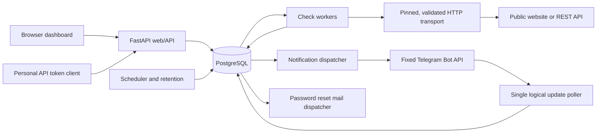

# Architecture

API Watch is a modular Python application with a same-origin web dashboard and a versioned REST API. The web process, check workers, and background services share domain code and PostgreSQL, but run independently. Opening the dashboard does not start a scheduler.

## Components

| Module | Responsibility |
| --- | --- |
| `app.py` | Application setup, error envelopes, request limits, security headers, static assets, health routes |
| `auth.py`, `api_utils.py`, `security.py` | Accounts, revocable sessions, CSRF, scoped API tokens, ownership, persistent rate limits, encryption |
| `schemas.py` | Request configuration validation, secret-free representations, JSON serialization |
| `monitors.py` | Monitor lifecycle, optimistic concurrency, manual checks, history, incidents |
| `checker.py` | Destination validation, pinned DNS transport, bounded response reads, HTTP and JSON evaluation |
| `engine.py` | Scheduling, leases, deployment-wide admission, destination limits, result application, retention, heartbeats |
| `telegram.py`, `integrations.py` | Private-chat linking, durable outbox, ordered delivery and retry, integration management |
| `statistics.py` | Observation-based success rates, latency summaries, chart buckets |
| `mail.py` | Password-reset delivery through SMTP or a local development mailbox |
| `db.py`, `models.py` | SQLAlchemy sessions, UTC timestamps, relational constraints |
| `cli.py` | Explicit migration and process commands |

The dashboard uses HTML, CSS, and JavaScript served by the API process. No separate frontend build or cross-origin session configuration is necessary. The chart and ordinary interactions work without a third-party frontend CDN.

## Why PostgreSQL is also the queue

Configuration, check admission, incidents, and notifications require consistent transactional changes. Keeping the queue and outbox in the same database avoids a second distributed transaction between a broker and PostgreSQL. A separate Redis, RabbitMQ, or Celery deployment is unnecessary at the first release's target scale.

This choice is deliberate: check history is append-oriented, queue operations use short transactions, and HTTP requests run outside database transactions. Future scaling can replace queue admission without changing the check/incident contract.

SQLite is available for local evaluation and unit tests. A single local background/worker deployment is supported there. PostgreSQL is required in production and for verifying coordination between processes; SQLite is not claimed to provide PostgreSQL's row-lock or advisory-lock guarantees.

## Persistent execution flow

1. The API validates and encrypts a monitor's request configuration and stores an immutable configuration version. Active monitors receive an immediate first due time.
2. Every second, the scheduler locks due monitor rows with `FOR UPDATE SKIP LOCKED`. It advances the anchored schedule and queues only the newest due slot.
3. Older missed slots become a bounded range in `schedule_gaps`. If the monitor is already busy, the current slot becomes a terminal `skipped / monitor_busy` result. Neither case creates a catch-up request storm.
4. A worker acquires the PostgreSQL admission advisory lock briefly, counts running live leases, then locks a queued monitor and check. The transaction commits before any network request begins.
5. The worker receives a random fencing token and a deadline of the request timeout plus 15 seconds. The checker validates DNS, then acquires a short-transaction destination lease for its chosen, already validated IP.
6. The HTTP client connects to that exact IP while retaining the hostname for HTTP Host, TLS SNI, and certificate verification. DNS is not repeated by the transport. A destination allows at most two live leases across workers.
7. Result application locks the monitor and run and verifies status, token, database-clock lease expiry, monitor activity, and configuration version. The result, health transition, incident transition, and outbox insertion commit together.
8. Expired runs become `interrupted / worker_lost`; their HTTP operation is never automatically repeated. A later scheduled slot can create a new check.

The database has a partial unique index allowing one `queued` or `running` check per monitor, including manual checks, and a unique `(monitor_id, scheduled_at)` constraint. Incident uniqueness is also enforced by a partial database index.

The global check cap is coordinated through PostgreSQL, not multiplied by the number of worker processes. Destination capacity is stored in `destination_leases`; transactions holding the per-IP advisory lock count and create leases atomically. Network exchange does not hold a pooled connection open. A lost worker's capacity expires with its run lease.

## Ordering and incident state

Execution state (`active`, `paused`, `deleted`) and observed health (`unknown`, `up`, `degraded`, `down`, `recovering`) are separate. A paused monitor can retain an open incident.

Only completed, scheduled `success` and `failure` observations affect failure/recovery streaks. Manual diagnostics do not affect health, scheduling, incidents, or scheduled statistics. A scheduled blocked/interrupted/cancelled/skipped result or missed slot breaks the streak and changes health to `unknown`; it does not report recovery.

The monitor's `last_applied_scheduled_at` watermark orders state changes by slot rather than completion speed. An older run can finish after a newer skipped slot and remain useful history without reverting the current health. Configuration changes reset this watermark and abort any open incident.

An incident starts at the finish time of the first failure in the confirming streak. Detection is the finish time of the failure reaching the threshold. Recovery starts at the first success in the final successful streak and is confirmed at its threshold. Duration describes an interval of observations, including confirmation time; it is not exact physical downtime.

## Delivery and account lifecycle

Incident events are immutable, safe snapshots in an outbox. A monitor's opening event precedes its recovery/abort event. Any terminal predecessor (`sent`, `failed`, `suppressed`, `cancelled`) unlocks the next event. Every delivery snapshots an encrypted recipient and a connection generation; reconnecting does not redirect queued old alerts to a new recipient.

The update poller holds a PostgreSQL session advisory lock around `getUpdates`. The durable update offset and link-code consumption commit together. Only a confirmed private chat can be linked. Notification retries never block check execution or incident transitions.

Password-reset links are one-use hashes with a 30-minute lifetime. Reset messages have an encrypted delivery payload that is erased after success or terminal failure. A password change or reset revokes browser sessions and personal API tokens. Account deletion cancels active runs and removes owned rows through foreign-key cascades.

## Operational boundaries

Automatic retries of monitored HTTP operations are prohibited, including after a timeout or `429`; state-changing APIs may already have received the request. Result application is idempotent in the database. Exactly-once execution at an external server and exactly-once Telegram delivery are not claimed.

Application-level SSRF controls are complemented by deployment egress restrictions; see [security.md](security.md). Backups must include the matching encryption key material; see [operations.md](operations.md). Performance targets and measured evidence are separated in [performance.md](performance.md).
